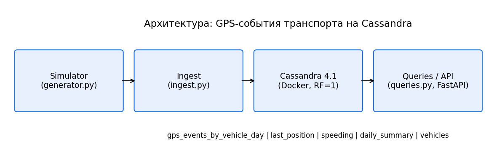

# GPS-события транспорта на Cassandra

Мини-проект по дисциплине «Проектирование и применение NoSQL-технологий» (3 курс, ОП «Информационные системы»).
**Вариант 13.** Технология: Apache Cassandra. Задача: история координат по машине и дню,
clustering order, контроль размера партиций.

- Котов Расул / группа: _24-22_
- Отчёт: [docs/report.pdf](docs/report.pdf)
- Презентация: [docs/presentation.pdf](docs/presentation.pdf)
- ADR: [docs/ADR.md](docs/ADR.md) · Требования и Access Patterns: [docs/requirements.md](docs/requirements.md)
- GitHub: _https://github.com/rasulmngoo/NowSQL.git_



## Идея модели
Таблица `gps_events_by_vehicle_day` с ключом `PRIMARY KEY ((vehicle_id, day), event_ts)` и
`CLUSTERING ORDER BY (event_ts DESC)`:

- партиция = машина + сутки (UTC), её размер ограничен (`scripts/partition_size.py`);
- свежие точки идут первыми, `LIMIT N` и срез по времени читают одну партицию;
- TTL 90 дней + TimeWindowCompactionStrategy (окно 1 день);
- денормализация: ещё 4 таблицы под остальные Access Patterns (последняя позиция, превышения, сводки, справочник).

## Быстрый старт
Нужны Docker и Python 3.10–3.12.

```bash
cp .env.example .env
docker compose up -d                  # дождитесь статуса healthy (1–2 минуты)
python -m venv .venv && source .venv/bin/activate    # Windows: .venv\Scripts\activate
pip install -r requirements.txt
python scripts/seed.py                # схема + 1800 событий (5 машин x 3 дня x 120) + сводки
python scripts/demo_queries.py        # 10 демонстрационных запросов
python scripts/partition_size.py --measure   # оценка и факт размера партиции
pytest -v                             # тесты (без Cassandra интеграционные тесты пропускаются)
uvicorn src.api:app --reload          # необязательно: REST, http://127.0.0.1:8000/docs
```

Без БД можно сгенерировать данные: `python scripts/seed.py --csv-only` (файл `data/sample_events.csv`, 1800 строк).

## Демонстрационные запросы (`scripts/demo_queries.py`)
| № | Что делает | AP |
|---|---|---|
| Q1 | Трек машины за день, новые первыми | AP1 |
| Q2 | Последние 5 точек (`LIMIT`) | AP2 |
| Q3 | Интервал 08:00–09:00 | AP3 |
| Q4 | Последняя позиция | AP4 |
| Q5 | Превышения скорости за день | AP6 |
| Q6 | Сводки за 30 дней | AP7 |
| Q7 | `count/max/avg` по партиции | — |
| Q8 | UPDATE и чтение справочника | AP8 |
| Q9 | **Нетривиальный:** трек за 3 дня, параллельные чтения + пробег (haversine) | AP5 |
| Q10 | **Нетривиальный:** постраничное чтение партиции (`fetch_size`) | AP10 |

## Тесты (`tests/`)
| Файл | Сценарий |
|---|---|
| `test_order.py` | Строки возвращаются по убыванию `event_ts`, `LIMIT` берёт самые новые |
| `test_day_boundary.py` | События 23:59:59 и 00:00:00 UTC попадают в разные партиции |
| `test_crud_ttl.py` | CRUD справочника, TTL ≤ 90 дней, удаление суток, идемпотентный upsert |
| `test_partition_size.py` | Размер партиции в лимите при 1 Гц; при 10 Гц нужен бакет по часу; haversine |

## Контроль размера партиции
Оценка ~100 байт на строку: 1 событие/5 с ≈ 1,7 МБ/сутки; 1/с ≈ 8,2 МБ; 10/с ≈ 82 МБ (нужен ключ `(vehicle_id, day, hour)`).
Факт проверяется командой `nodetool tablestats` (см. `--measure`).

## Структура
```
src/       config, models, db, ingest, queries, geo, generator, api
scripts/   init_schema.cql, seed.py, demo_queries.py, partition_size.py, draw_architecture.py
tests/     pytest-тесты
data/      sample_events.csv (синтетика)
docs/      ADR.md, requirements.md, architecture.png, report.pdf, presentation.pdf
```

## Ограничения
Нет гео-запросов и произвольной фильтрации; сводки поддерживает приложение; демо на одном узле (RF=1)
не показывает отказоустойчивость (production: 3+ узла, RF=3, `LOCAL_QUORUM`); сутки считаются по UTC.
